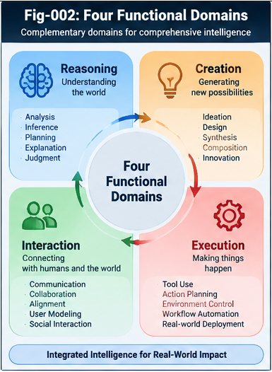
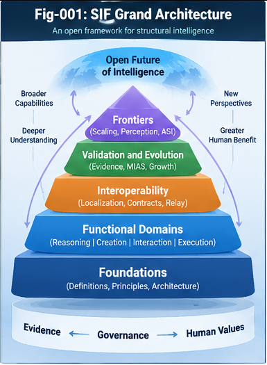
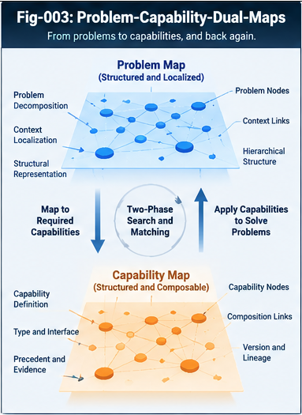
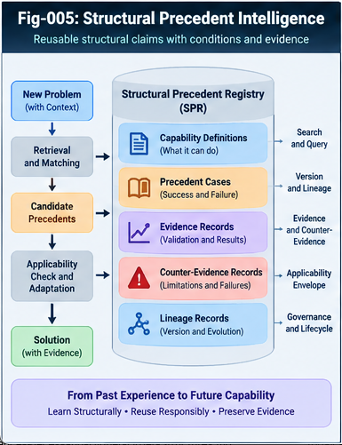
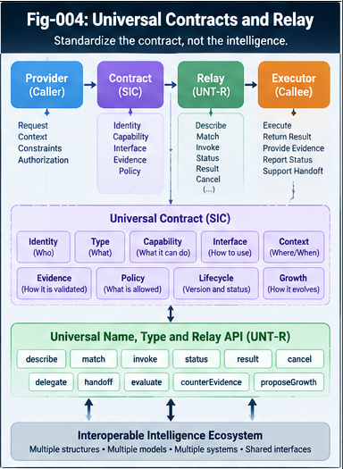
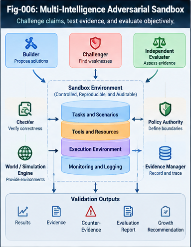
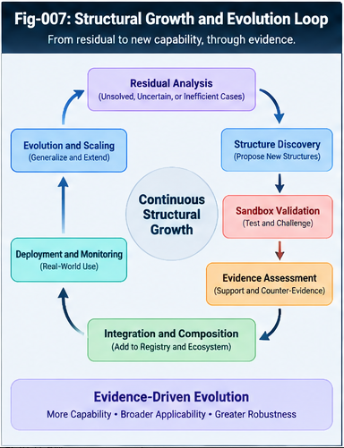
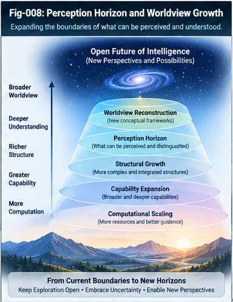

# Structural Intelligence Framework (SIF)

### An Open Architecture for Intelligence Localization, Composition, Governance, and Structural Growth

**Sizhe Tan & GPT-Obot** · **v1.0.0** · **Apache-2.0**

> **Structural intelligence does not merely solve problems within a worldview; through evidence-governed, open-ended structural growth, it may expand and reconstruct the worldview itself.**

**SIF** is a research framework for discovering, addressing, composing, validating, governing, and evolving heterogeneous intelligence structures. It treats large language models (LLMs) as powerful foundational capabilities—not as the exclusive or final form of intelligence. The framework welcomes existing methods, future methods, and replacements, subject to explicit contracts, evidence, counter-evidence, and authorization boundaries.

**Project status:** Conceptual architecture, candidate research specifications, and a falsifiable validation agenda. **This v1.0.0 release is not a validated implementation, a benchmark result, or an adopted interoperability standard.**

---

## 1. Why SIF?

Individual models and tools can be highly capable yet remain isolated by incompatible interfaces, implicit assumptions, narrow evaluation, and weak mechanisms for structural learning. Adding tools alone does not resolve these problems. SIF asks a broader question:

**How can intelligence capabilities become discoverable, composable, challengeable, portable, and capable of evidence-governed structural evolution?**

SIF draws a distinction between **improving a solution inside a known structure** and **improving the structure through which problems and solutions are represented**. Its architecture is open-ended in the sense that its inventory of intelligence structures is not assumed complete; this is a design principle, not a claim of unlimited growth.

## 2. The Four Functional Domains

These are **functional roles**, not mutually exclusive software layers. One structure—such as an LLM, a world model, or a scoring system—may contribute to several domains.

| Domain | Core question | Representative mechanisms |
|---|---|---|
| **I. Localization and Intelligence Addressing** | Where is the relevant problem, context, capability, or execution path? | LLMs, Metric-Space CCC, MDT, Two-Phase Search, CallingGraph, Core + Delta, relay networks, UTN, world models |
| **II. Per-Node Intelligence** | What intelligence can a node perform? | LLMs, rules, Two-Way CCC, ANN, optimization, simulation, mathematical programming, specialized applications and APIs |
| **III. Universal Control Planes and Scoring/Folding** | How are alternatives assessed, controlled, audited, and authorized? | Policy/authority, scoring trees and forests, evidence/audit, structural folding and unfolding |
| **IV. Residual-Based Structural Growth** | What is missing, failing, uncertain, or newly possible—and how should the architecture change? | Residual diagnosis, precedent adaptation, adversarial validation, new PIRP/PIRU units, collective learning |

**Important separation:** capability matching is not validation; validation is not authorization. Governance applies across all four domains.

## 3. From Isolated Tools to Structural Intelligence

SIF organizes intelligence through **three complementary engineering systems**:

1. **Structural Intelligence Registry** — what capabilities and precedents exist, with their versions, applicability conditions, supporting evidence, and counter-evidence.
2. **Structural Intelligence Runtime** — how capabilities are addressed, matched, composed, relayed, and executed under explicit policies.
3. **Structural Intelligence Evolution Laboratory** — how new structural candidates are proposed, challenged, compared, revised, and qualified before possible deployment.

These systems are connected by shared identities, types, contracts, traceable evidence, and governance boundaries.

## 4. Problem–Capability Dual Maps

SIF distinguishes two complementary views:

- **Structural Problem-Solving Map (PSM):** the tasks, goals, constraints, context, dependencies, and success criteria a problem requires; analogous to a *Task CallingGraph*.
- **Structural Capability Map (SCM):** available capabilities, their interfaces, composition relationships, applicability conditions, and evidence; analogous to an *Action CallingGraph*.

**Bidirectional Structural Intelligence Mapping (BSIM)** connects them. Problems can lead to relevant capabilities, while newly discovered capabilities can reveal previously unrecognized applications or questions. A failed mapping becomes a candidate **structural residual**, not an automatic proof that a new intelligence has been invented.

## 5. Structural Precedent Intelligence

Inspired by the logic of legal precedents, **Structural Precedent Intelligence (SPI)** treats prior structural solutions as conditional, challengeable claims—not universally reusable answers. The **Structural Precedent Registry (SPR)** records capability definitions, precedent cases, evidence, counter-evidence, and lineage.

A precedent must be checked against the new task's context, assumptions, constraints, and risk. Retrieval, adaptation, validation, and authorization remain distinct operations.

## 6. Universal Contracts, Naming, Typing, and Relay

SIF proposes a **Structural Intelligence Contract (SIC)** to describe identity, type, capabilities, signatures, context assumptions, relay interfaces, evidence, policy, lifecycle, and growth hooks. **Universal Naming, Typing and Relay (UNT-R)** provides candidate conventions for addressing and connecting heterogeneous intelligence units.

The baseline relay operations proposed for research are `describe`, `match`, `invoke`, `status`, `result`, and `cancel`. Additional operations may support delegation, handoff, evaluation, counter-evidence, and growth proposals.

**Standardize the contract, not the intelligence.** Flexible **Portable Intelligence Runtime Pieces (PIRP)** may mature into more formal **Portable Intelligence Runtime Units (PIRU)** without requiring uniform internal algorithms.

## 7. Challenge the Structure, Not Just the Answer

The proposed **Multi-Intelligence Adversarial Sandbox (MIAS)** separates roles such as Builder, Challenger, Independent Evaluator, World/Simulation Engine, Formal Checker, and Policy Authority. It tests both candidate performance and structural assumptions: applicability, representation, composition, evaluator reliability, costs, and failure modes.

**Structural Counter-Evidence (SCE)** is a first-class research artifact. An evaluator can itself be challenged, within bounded resources and risk controls, to mitigate Goodhart-style metric gaming.

Three boundaries must not be conflated:

- **Exploratory sandbox:** generate and challenge candidates within isolated limits.
- **Validated shadow runtime:** observe behavior without granting production authority.
- **Authorized production runtime:** execute only within separately approved permissions and monitoring requirements.

## 8. Open-Ended Growth and the Perception Horizon

SIF studies growth across **large structures, deep structural granularity, precision guidance, and computational investment**, together with interoperability, evidence, governance, and collective learning. Higher-order compositions may become **Macro-Intelligence Pieces**—systems reusable as nodes in larger systems—if their contracts and boundaries remain intelligible and testable.

The **Structural Perception Horizon** describes what a system can currently distinguish, represent, connect, and evaluate. The frontier hypothesis is that structural growth may expand that horizon and, in some cases, reorganize a system's **worldview** (its conceptual perspectives), rather than merely improving performance within an unchanged **world model**.

**Perspective-relative ASI** is treated as conditional on domain, task, evidence, metrics, resources, time horizon, and governance—not as an automatic universal status.

## 9. Read the Research

**New readers:** begin with [START-HERE.md](START-HERE.md), then consult the full [CONTENTS.md](CONTENTS.md) and [GLOSSARY.md](GLOSSARY.md).

### Foundations

- [SIF-001 — From Isolated Intelligence to Open Structural Intelligence](docs/foundations/SIF-001-From-Isolated-Intelligence-to-Open-Structural-Intelligence.md)
- [SIF-002 — Four Functional Domains of Structural Intelligence](docs/foundations/SIF-002-Four-Functional-Domains-of-Structural-Intelligence.md)
- [SIF-003 — Structural Precedents and Open Intelligence Evolution](docs/foundations/SIF-003-Structural-Precedents-and-Open-Intelligence-Evolution.md)

### Functional Domains

- [SIF-004 — Localization and Intelligence Addressing](docs/functional-domains/SIF-004-Localization-and-Intelligence-Addressing.md)
- [SIF-005 — Per-Node Intelligence and Multi-Perspective Capabilities](docs/functional-domains/SIF-005-Per-Node-Intelligence-and-Multi-Perspective-Capabilities.md)
- [SIF-006 — Universal Control Planes and Scoring Folding](docs/functional-domains/SIF-006-Universal-Control-Planes-and-Scoring-Folding.md)
- [SIF-007 — Residual-Based Structural Growth](docs/functional-domains/SIF-007-Residual-Based-Structural-Growth.md)

### Interoperability

- [SIF-008 — Dual Maps and Bidirectional Structural Mapping](docs/interoperability/SIF-008-Dual-Maps-and-Bidirectional-Structural-Mapping.md)
- [SIF-009 — Structural Precedent Registry](docs/interoperability/SIF-009-Structural-Precedent-Registry.md)
- [SIF-010 — Universal Naming, Typing and Relay](docs/interoperability/SIF-010-Universal-Naming-Typing-and-Relay.md)
- [SIF-011 — Structural Intelligence Contracts and Portable Units](docs/interoperability/SIF-011-Structural-Intelligence-Contracts-and-Portable-Units.md)

### Validation and Evolution

- [SIF-012 — Multi-Intelligence Adversarial Sandbox](docs/validation-and-evolution/SIF-012-Multi-Intelligence-Adversarial-Sandbox.md)
- [SIF-013 — Structural Counter-Evidence and Evaluator Governance](docs/validation-and-evolution/SIF-013-Structural-Counter-Evidence-and-Evaluator-Governance.md)
- [SIF-014 — Open-Ended Structural Growth and Collective Learning](docs/validation-and-evolution/SIF-014-Open-Ended-Structural-Growth-and-Collective-Learning.md)

### Frontiers

- [SIF-015 — Structural Perception Horizon and Worldview Growth](docs/frontiers/SIF-015-Structural-Perception-Horizon-and-Worldview-Growth.md)
- [SIF-016 — Macro-Intelligence Pieces and Higher-Order Structures](docs/frontiers/SIF-016-Macro-Intelligence-Pieces-and-Higher-Order-Structures.md)
- [SIF-017 — Scaling Axes and Computational Intelligence Growth](docs/frontiers/SIF-017-Scaling-Axes-and-Computational-Intelligence-Growth.md)
- [SIF-018 — Perspective ASI and the Open Future of Intelligence](docs/frontiers/SIF-018-Perspective-ASI-and-the-Open-Future-of-Intelligence.md)

### Candidate Research Specifications

These are **proposals for experimentation**, not ratified standards.

- [SPEC-001 — SIF Structural Intelligence Contract](specifications/SPEC-001-SIF-Structural-Intelligence-Contract.md)
- [SPEC-002 — Universal Name, Type and Relay API](specifications/SPEC-002-Universal-Name-Type-and-Relay-API.md)
- [SPEC-003 — Structural Precedent Registry Schema](specifications/SPEC-003-Structural-Precedent-Registry-Schema.md)
- [SPEC-004 — Sandbox Evidence and Growth Lifecycle](specifications/SPEC-004-Sandbox-Evidence-and-Growth-Lifecycle.md)

### Research Program

- [Open Questions](research/OPEN-QUESTIONS.md)
- [Testable Hypotheses](research/TESTABLE-HYPOTHESES.md)
- [Validation Roadmap](research/VALIDATION-ROADMAP.md)
- [Future Directions](FUTURE-DIRECTIONS.md)
- [Figure Index](FIGURE-INDEX.md)

## 10. Relationship to the Structural Intelligence Research Program

SIF is intended as an **integrating architectural framework**, not a replacement for the specialized research repositories on Metric Differential Trees and UTN/CBT, CallingGraph unfolding, structural folding, Principle Intelligence, portable intelligence units, structural recursive self-improvement, generalized triggers, universal control planes, or intelligence beyond LLM boundaries. Their specific hypotheses and mechanisms retain their own scope and should be evaluated on their own evidence.

For related public work, see the [Sizhe Tan GitHub profile](https://github.com/sizhet) and the references discussed within the SIF manuscripts. Cross-repository compatibility is a research goal, not an established interoperability result.

## 11. Research Commitments and Limits

SIF is committed to **falsifiability, reproducibility, provenance, counter-evidence, bounded experimentation, and explicit human or institutionally delegated authority**. Its research program should be able to show when a proposed structural mechanism is ineffective, unnecessary, unsafe, or inferior to simpler baselines.

At v1.0.0, the repository provides **18 research manuscripts, 4 candidate specifications, 3 research planning documents, and an 8-figure architecture plan**. It does **not** claim demonstrated ASI, proven open-ended self-improvement, universal semantic interoperability, or experimentally verified worldview reconstruction.

## 12. Citation, License, and Release

**Authors:** Sizhe Tan & GPT-Obot  
**Project:** *Structural Intelligence Framework (SIF): An Open Architecture for Intelligence Localization, Composition, Governance, and Structural Growth*  
**Release:** v1.0.0  
**Repository:** https://github.com/sizhet/Structural-Intelligence-Framework  
**License:** [Apache License 2.0](LICENSE.txt)  
**Citation metadata:** [CITATION.cff](CITATION.cff)  
**Change history:** [CHANGELOG.md](CHANGELOG.md)

A DOI may be added to the citation metadata after a verified archival release; none is asserted here.

---

## Authors

**Sizhe Tan & GPT-Obot**

DOI: 10.5281/zenodo.23648359

---

## 📚 DBM-SI Series Navigation

See:\
[./docs/DBM-SI-Series-of-gitHub-Repositories/DBM-SI-Series-of-gitHub-Repositories.md](./docs/DBM-SI-Series-of-gitHub-Repositories/DBM-SI-Series-of-gitHub-Repositories.md)

---

**Open intelligence requires open discovery, rigorous counter-evidence, interoperable contracts, and deliberate governance.**

